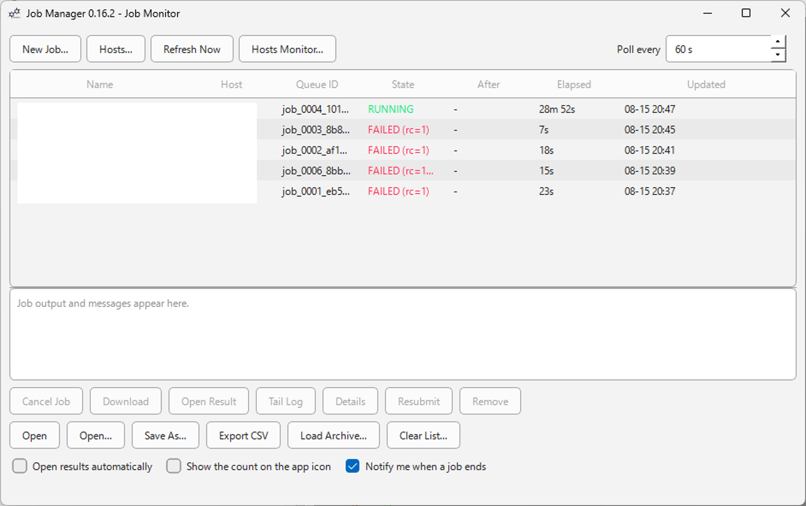
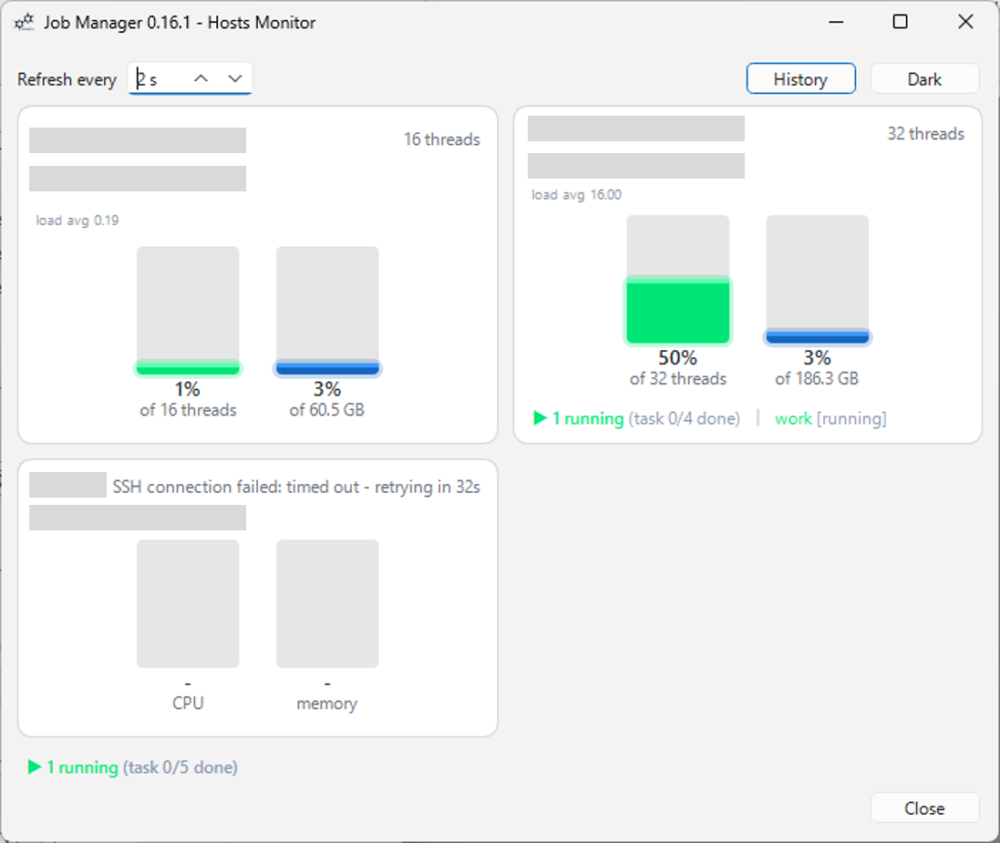

# Job Manager

[](https://doi.org/10.5281/zenodo.22671687)
[](https://github.com/HiroYokoyama/moleditpy_job_manager/actions/workflows/tests.yml)

[](https://github.com/HiroYokoyama/moleditpy_job_manager/tags)
[](https://github.com/HiroYokoyama/moleditpy_job_manager/releases)
[](LICENSE)
[](https://github.com/HiroYokoyama/python_molecular_editor)

A [MoleditPy](https://github.com/HiroYokoyama/python_molecular_editor) plugin for
running calculations over SSH, locally, inside WSL, or through a LAN Job Server.
Upload inputs, submit jobs, monitor progress, fetch results and open them in the
editor. It also runs as a standalone desktop application.




## Features

- **Submit calculations** to SLURM, PBS/Torque, SGE/UGE, a background process,
  or [MoleditPy Job Server](docs/JOB_SERVER.md). Native Windows jobs use PowerShell;
  WSL jobs use bash inside the selected Linux distribution.
- **Manage workstation resources** with a built-in queue that schedules by
  physical cores and memory. Pause the queue, change its limits, chain jobs,
  or schedule a later start. Jobs continue with MoleditPy closed.
- **Reuse inputs and settings.** Save command templates and resource presets,
  submit files already on the host, or relay a predecessor's outputs into a new
  job. ORCA, Gaussian, Psi4, NWChem, Q-Chem and GAMESS inputs can supply their own
  core and memory requests.
- **Monitor jobs and hosts.** Sort and filter jobs, browse remote files and logs,
  and view CPU, memory and load in the Host Monitor. Desktop notifications,
  task-bar progress, a tray icon and Slack/Discord/Teams webhooks are available.
- **Collect results.** Download outputs automatically beside the input file and
  open them through the installed result analyzer. Save job lists as `.pmejbs`,
  export CSV, or rebuild a read-only list from existing result folders.
- **Submit from other tools.** ORCA and Gaussian Input Generator Pro provide a
  **Submit to Cluster...** button. Scripts and other applications can use the
  optional [local HTTP API](docs/API.md).

Detailed instructions: [Standard workflow](docs/WORKFLOW.md).

## Requirements

- MoleditPy 4.x, or Python 3.9+ with PyQt6 for standalone use.
- **SSH destinations:** an SSH client for OpenSSH, or `pip install paramiko`
  for the optional backend with password authentication.
- **Local destinations:** bash, or the Windows scheduler with PowerShell.
- **WSL destinations:** Windows with a WSL distribution that contains bash.
- **Job Server destinations:** the optional `cryptography>=50.0.2` package.
  The HTTP client is bundled; see [Job Server setup](docs/JOB_SERVER.md).

## Usage

1. Open **Extensions → Job Manager → Job Monitor**, then **Hosts...**.
   Add a host, choose its backend and scheduler, configure its working directory,
   and press **Test Connection**.
2. Select **New Job...**, add inputs, set resources, and choose a command from
   **Template...**. Check **Script preview** before submitting. Save a preset
   to reuse the settings.
3. Watch the job table or open its log. Completed outputs can be downloaded
   automatically and opened in the appropriate result analyzer.

Drop an input file onto the Job Monitor to open a prefilled submission. Dropping
several files creates one job per file; hold **Shift** to submit them together.
For staged inputs, select **Work already on the host** and check the existing
remote directory. Command-only jobs need no input file.

### Command templates and file paths

Templates cover ORCA, Gaussian, CP2K, GAMESS, MOPAC, NWChem, Psi4, PySCF,
Quantum ESPRESSO, VASP and xTB. Use the full executable path when needed,
especially for ORCA: a bare `orca` can resolve to the Linux screen reader.

Placeholders accept either `{input}` or `[input]`. Available fields include
`input`, `stem`, `basename`, `output`, `nodes`, `ntasks`, `cpus`, `memory`,
`walltime` and `queue`. Save custom commands through **Template... → Save
current command as...**.

The input table shows **File**, **Folder** and **Status**. Add or paste paths,
or drag files onto the dialog. **Move up / Move down** selects the first input
used by `{input}`. Inputs with the same upload filename must be renamed or
submitted separately.

See [command placeholders](docs/COMMAND_PLACEHOLDERS.md) and the
[standard workflow](docs/WORKFLOW.md#3-submit) for examples and program-specific
requirements.

## Backends

| Backend | Runs on | Requirements and authentication |
|---|---|---|
| OpenSSH (default) | Remote Linux or Windows host | `ssh` and `scp`; keys and ssh-agent; inherits `~/.ssh/config` and supports `ProxyJump` |
| paramiko | Remote Linux or Windows host | Optional `paramiko` package; keys, agent or passwords; `ProxyJump` is refused |
| This machine | Local Linux, macOS or Windows | No network or authentication; bash or the Windows PowerShell scheduler |
| WSL | A Linux distribution on this Windows machine | WSL with bash; no SSH or authentication |
| Job Server (HTTPS) | A LAN computational helper | Optional `cryptography>=50.0.2`; registered device key; bundled HTTP client |

OpenSSH uses batch mode so a background operation cannot wait for an invisible
password prompt. For password-only hosts, choose paramiko and enable **Ask for a
password when connecting**. SSH passwords stay in session memory and are never
written to disk. Unknown host keys require fingerprint approval.

For WSL, choose the distribution in **Hosts...** and use a Linux **Remote root**
such as `~/moleditpy_jobs`. Inputs are copied into the distribution and results
back to Windows. Files within the selected distribution can also be supplied
through `\\wsl.localhost\Ubuntu\...` paths.

See [WSL setup](docs/WORKFLOW.md#running-inside-wsl),
[Job Server setup](docs/JOB_SERVER.md), and the
[security model](docs/SECURITY_MODEL.md).

### Verified backends

These configurations have been checked with real jobs through submission,
completion tracking, log reading and result download. Local and WSL checks
cover both direct background mode and the built-in helper queue.

| Backend | Verified environment | Evidence |
|---|---|---|
| OpenSSH | Linux hosts without a cluster scheduler | Verified in real use |
| paramiko | Linux hosts without a cluster scheduler | Verified in real use |
| This machine — bash | Linux and Git Bash on Windows | Real shell execution in the test suite and CI |
| This machine — Windows scheduler | Native Windows PowerShell | Real direct and queued job execution in Windows CI |
| WSL | Windows with Ubuntu, using real `wsl.exe` and bash | Verified locally with version **2.6.3** on **2026-10-14** |

The Ubuntu checks include Windows input files, `\\wsl.localhost` paths, existing
job directories, failed-command exit codes and jobs that continue after
submission returns. Version **2.6.3** fixes a WSL launch race that could leave a
job pending without a log. Real WSL tests run when a distribution with bash is
available; Windows CI also tests the transport through a shell-backed stand-in.

OpenSSH and paramiko are verified against real hosts; their automated transport
tests additionally use mocked connections. SLURM, PBS/Torque and SGE/UGE have
scheduler unit tests, but have not yet been verified on a real cluster. Reports
with the scheduler version and error text are welcome.

## Scheduling and monitoring

On hosts without a cluster scheduler, the helper queue dispatches jobs within
physical-core and memory budgets. It runs only while work remains, keeps its
queue in readable files on the host, and supports dependencies, pausing and
scheduled starts. A chained-lanes mode is also available.

Cluster jobs use the scheduler's own dependency and submission flags. Configure
**Submit options** on the host or preset for billing groups, resource groups or
other arguments that belong on the `sbatch`/`qsub` command line. Host options
come first; arguments are parsed and quoted individually.

Polling uses one queue-status request per host per cycle. The default is
**120 seconds**, with a minimum of 5 seconds and a warning below 30 seconds.
Polling stops when no jobs are active; connection failures trigger backoff.
Use a longer per-host interval for shared login nodes and disable or slow host
CPU/memory sampling where appropriate. **Refresh Now** requests an update;
**View → Reload List** (`Ctrl+R`) rereads the saved job list.

Generated wrappers write an exit-code sentinel atomically when they exit:
zero means **DONE**, a nonzero code means **FAILED**, and a missing sentinel
after the job disappears means **LOST**. Signal traps record termination codes
such as 143 for SIGTERM. Jobs blocked by a failed dependency show **BLOCKED**.

See the [helper queue](docs/RUNNER.md),
[job states](docs/WORKFLOW.md#reading-job-states), and
[troubleshooting](docs/WORKFLOW.md#troubleshooting).

Dependencies form a chain, with one predecessor per job. There is no workflow
graph or automatic retry; complex cluster dependencies can be supplied through
extra scheduler directives. Job Server has its own queue and feature limits,
described in [its setup guide](docs/JOB_SERVER.md).

## Standalone mode

Launch the full Job Manager without opening MoleditPy:

```bash
python -m job_manager
python -m job_manager --host-monitor
```

Alternatively, run `python __main__.py` inside the plugin folder. On Windows,
use `launch_job_manager.bat` or `launch_host_monitor.bat`; create a desktop
shortcut to either file for one-click access. They use `pythonw` to avoid a
persistent console window.

Standalone uses the same hosts, job list, downloads and notifications as the
plugin. Opening results in the molecular editor requires MoleditPy.

A second standalone launch brings the existing Job Manager to the front instead
of starting another tracker. In **Settings...**, **Keep the Job Manager running
after MoleditPy closes** can leave it in the tray to poll, notify and download.
This option is off by default.

## Integrations

### Input generators and scripts

ORCA and Gaussian Input Generator Pro offer **Submit to Cluster...** beside
Save when Job Manager is installed. Other plugins can call
`job_manager.submit_file(paths, name="")` through the host's plugin list.

For external programs, enable **Local API...** under **Extensions → Job
Manager**. The API is off by default and binds only to `127.0.0.1`.

```bash
python -m job_manager.api_client submit h2o.inp --host mycluster --command "/opt/orca/orca {input} > {stem}.out" --cpus 8 --memory 16GB
python -m job_manager.api_client wait JOB_ID --download
```

```python
from job_manager.api_client import JobManagerClient

client = JobManagerClient()
job = client.submit(
    host="mycluster",
    files=["h2o.inp"],
    command="/opt/orca/orca {input} > {stem}.out",
)
final = client.wait(job["id"])
```

The client discovers the running Job Manager and uses the same submission
service as the GUI. See [API documentation](docs/API.md) for authentication,
endpoints and client examples.

### Web monitor and notifications

Enable **Serve the Host Monitor to a browser** in **Settings... → Web Monitor**
for a read-only browser dashboard. It binds to `127.0.0.1`; **Links and
Tailscale...** can publish it to your tailnet after HTTPS certificates are
enabled. The monitor works from the tray process too, and samples hosts only
while someone is viewing the page.

See the [web monitor guide](docs/WEB_MONITOR.md) for setup, access controls,
refresh intervals and data usage. For desktop alerts and Slack/Discord/Teams
webhooks, see [notifications](docs/WORKFLOW.md#being-told-when-a-job-ends).

## Where your data lives

Persistent state is stored in `~/.moleditpy/job_manager/`, outside the plugin
folder so updates preserve it.

| File or folder | Purpose |
|---|---|
| `settings.json` | Hosts, presets, command templates and preferences; SSH passwords are not stored |
| `jobs.pmejbs` | Tracked jobs, retained across application restarts |
| `archived/jobs_<date>.pmejbs` | Job lists preserved by **Clear List** |
| `downloads/` | Fetched results |
| `api_token` / `api.json` | Local API secret and active endpoint |
| `web_monitor_token` | Persistent web-monitor access token, separate from the API secret |

Job lists can be saved, reopened or exported to CSV. Archived lists open read-only.
Result-folder imports also produce read-only lists. See
[job-list management](docs/WORKFLOW.md#7-keeping-exporting-and-clearing-the-list)
and the [security model](docs/SECURITY_MODEL.md) for storage and trust boundaries.

## Documentation

| Guide | Covers |
|---|---|
| [Standard workflow](docs/WORKFLOW.md) | Setup, submission, results, notifications and troubleshooting |
| [Job Server](docs/JOB_SERVER.md) | LAN server setup, authentication and supported operations |
| [Helper queue](docs/RUNNER.md) | Dispatch, dependencies, resource budgets and queue files |
| [Command placeholders](docs/COMMAND_PLACEHOLDERS.md) | Command fields and expansion rules |
| [Local API](docs/API.md) | External clients, endpoints and authentication |
| [Web monitor](docs/WEB_MONITOR.md) | Browser dashboard, Tailscale and data usage |
| [Architecture](docs/ARCHITECTURE.md) | Service layers, threading, polling and plugin integration |
| [Security model](docs/SECURITY_MODEL.md) | Credentials, host keys, downloads and trust boundaries |

## Development

```bash
python -m pytest tests/ -q -n auto
ruff format job_manager tests
ruff check job_manager tests
```

Most protocol and transport tests use fakes or mocks. Execution tests run actual
bash or PowerShell scripts; WSL tests use a stand-in or a real installed
distribution. GUI tests require PyQt6. Tests with the real MoleditPy
`PluginContext` also require a main-app checkout and `rdkit`.

CI covers Python 3.11–3.13, real Qt, native Windows and integration with
MoleditPy. Optional test tiers skip when their prerequisites are absent; CI
enforces the tiers assigned to each job. See [CLAUDE.md](CLAUDE.md) for the
development and release workflow.

## License

GNU General Public License v3.0. See [LICENSE](LICENSE).
